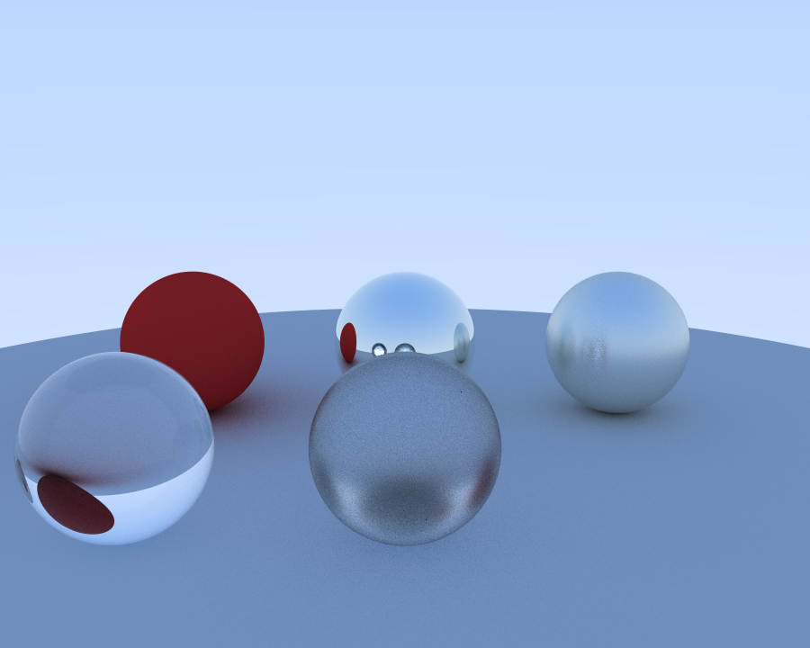
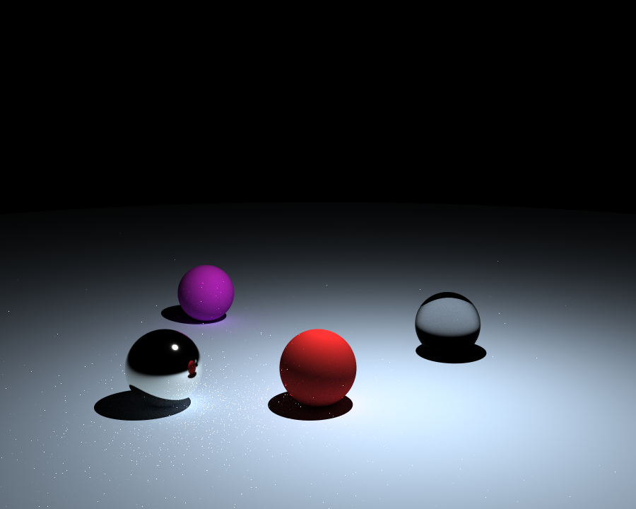
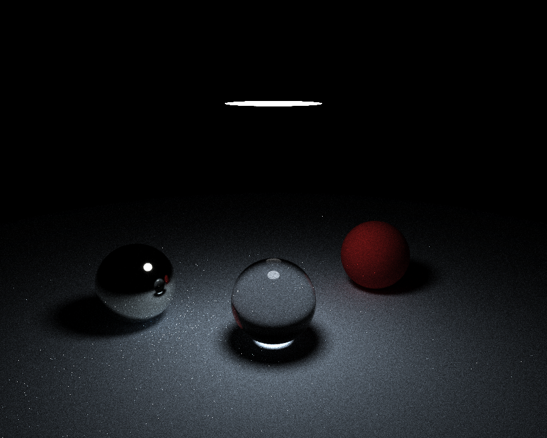
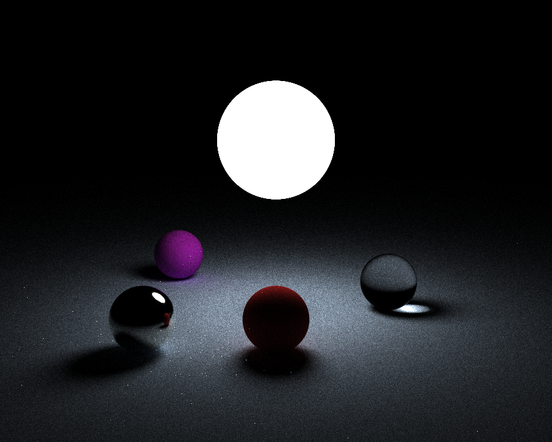
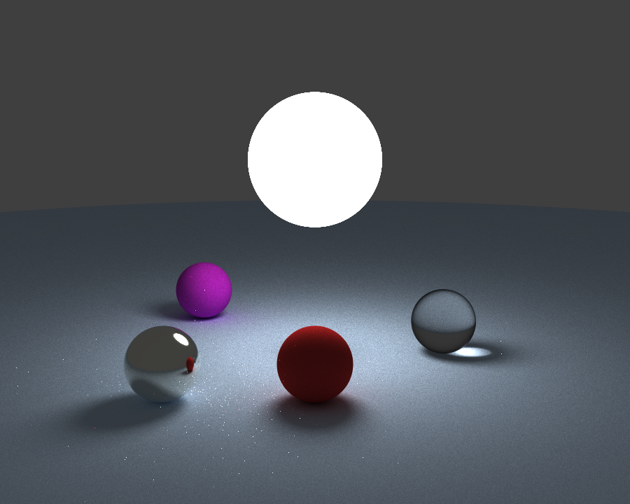

# vulkan-pbr

A physically-based renderer implemented in C++23, following the
[Physically Based Rendering: From Theory to Implementation](https://pbr-book.org/) book.

The project starts as a CPU-only ray tracer and will progressively evolve
to leverage GPU acceleration via Vulkan.

## Implemented Primitives

- Plane
- Disk
- Sphere
- Cube

## Materials

- Diffuse
- Conductor
- Dielectric
- Roughness via Microfacet Theory

## Result

Materials preview: Diffuse, Conductor, Dielectric



Scene with a single point light



Scene with a single diffuse area light (disk)



Scene with a single diffuse area light (sphere)



Scene with a single diffuse area light (sphere) and environment lighting




## Requirements

- CMake 4.0 or newer
- Ninja build system
- A compiler with C++23 module support:
  - GCC 16+ or Clang 22+
- Vulkan SDK

## Building with GCC

```bash
cmake --preset gcc-debug
cmake --build --preset gcc-debug
```

## Manual configuration (without presets)

```bash
cmake -B build -G Ninja -DCMAKE_BUILD_TYPE=Debug
cmake --build build
```

## Running 

```bash
./build/gcc-debug/vulkan-pbr
```
